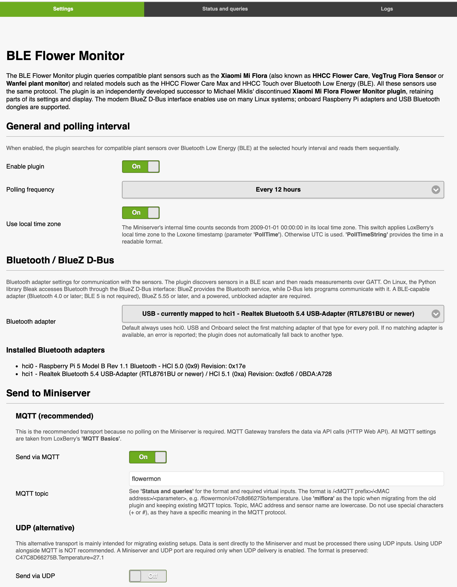

# LoxBerry Plugin: BLE Flower Monitor

The BLE Flower Monitor plugin is an independently developed successor to Michael Miklis' discontinued
[Xiaomi  MiFlora Flower Sensor Plugin](https://github.com/michaelmiklis/loxberry-plugin-miflora),
retaining parts of its settings and display. The modern BlueZ D-Bus interface enables use on many Linux
systems; onboard Raspberry Pi adapters and USB Bluetooth dongles are supported.

This plugin queries compatible plant sensors such as the Xiaomi Mi Flora (also known
as HHCC Flower Care, VegTrug Flora Sensor or Wanfei plant monitor) and related models such as the HHCC
Flower Care Max and HHCC Touch over Bluetooth Low Energy (BLE) using **Bleak and the standard
BlueZ D-Bus API**. All these sensors use the same protocol.

**MQTT is the recommended transport.** UDP remains available as an alternative
for existing setups. Existing MQTT topics, UDP payloads and hourly polling intervals are
preserved.




## Requirements and installation

- BLE Flower Monitor uses a new LoxBerry plugin identity and installs alongside
  the legacy Xiaomi Mi Flora plugin; it does not replace it or import its
  settings. Copy settings manually and disable the legacy plugin before
  enabling this one to avoid overlapping Bluetooth scans.
- Linux with **Python 3.9 or later** and **BlueZ 5.55 or later**, for example a
  current LoxBerry installation based on Debian 11 (Bullseye) or newer. Older LoxBerry
  images must be upgraded first; the installer reports unsupported runtimes.
- A powered, unblocked Bluetooth LE adapter, with the `bluetooth` service running.
- MQTT Basics configured in LoxBerry when MQTT delivery is enabled.
- Internet access during installation to install the Python dependencies.

The installer installs BlueZ, D-Bus and Python venv support, starts BlueZ and
creates a plugin-local `bin/venv` with Bleak and paho-mqtt. It does not modify
system Python packages or remove old shared bluepy installations. Polling
runs as the normal LoxBerry user through BlueZ's standard system-bus policy.
Systems with custom D-Bus restrictions must permit that user to communicate
with `org.bluez`. Sensors are discovered from BLE advertisements, then the
plugin connects to each sensor and reads its measurements through GATT using
Bleak and BlueZ's D-Bus API. A BLE 4.0-capable adapter is sufficient; the
plugin does not require BLE 5 features.

## Settings

The navigation follows other Loxbery plugins, with **Settings**, **Status and queries** and
**Logs** tabs. Settings contains scheduling, adapter selection, the installed
adapter inventory and a **Send to Miniserver** section with subordinate MQTT
and UDP options. Labels and controls are displayed side by side, stacking on
small screens. 

Status and queries contains a live query viewer and support setting up sensors in Loxone
config as virtual inputs with copy&paste.
Each query reports the configured adapter type (USB/Onboard/Default)
and the resolved controller, including its detailed adapter description, in the
live progress display. **Poll now** uses the saved settings, so you need to 
adjust all settings first. A detailed output of all parameters, their meaning, values,
and virtual input names or command recognition strings that can be copied and inserted
in Loxone config. Step-by-step instructions will help you to to integrate these flower sensors into Loxone Config.

One click immediately shows that a scan is starting, then refreshes progress
and measurements every second. Concurrent manual and scheduled queries are prevented internally by the same lock, including the web-to-poller
handoff. **Auto-scroll** can be switched off to inspect earlier lines;
**Download** exports the displayed progress as text. Status updates automatically
every second, so there is no separate refresh button. Measurements appear only
once in the viewer; the raw last-data file is not appended again at the end.

### Query logs

Each scan, the results and duration, including failed queries are stored in separate log files with configured log level.
Use the standard log-level selector included in LoxBerry's log list.
Each actual manual or scheduled query has a separate file in the plugin log
directory that is stored on a RAM disk, so logs may disappear after reboot.
Log-file links open LoxBerry's standard log viewer in a new browser tab and open
in a full-window layout with scrolling, download and close controls. Plugin 
log messages are always English. The RSSI estimate is shown as
`approx. ... m line of sight without walls`. 

LoxBerry manages retention and deletes old logs; the plugin does not delete log
files. Retention is not a guaranteed number of days: the system's hourly
maintenance can also limit the number of sessions per plugin/log group (24 on
the inspected LoxBerry 4 installation), so repeated manual queries can displace
older sessions quickly. Download important logs before they are removed.

### Languages

The web UI and help are available in
German (de), English (en), Spanish (es), Czech (cs), Dutch (nl), Polish (pl)
and Slovak (sk), using LoxBerry's language selection. 

### Bluetooth adapter

The plugin support onboard chipsets e.g. for all Raspberry PI models as well as
USB bluetooth dongles. An external USB bluetooth adapter is recommended for rPI's, 
because the internal antenna is shared with WiFi/WLAN and there is no support to 
connect an external antenna by default. Cheap adapters with Realtek 8761BU chipset 
have good support in many Linux distributions. The 8761 chipset supports bluetooth 5.1, but
USB dongles may be offered as 'Realtek Bluetooth 5.4 USB-Adapters'. You can identify
USB adapters in Linux by 'lsusb' command and VID:PID for these adapters is 0BDA:A728.

The selection of a bluetooth adapter is done by keyword 'onboard' or 'USB' and not by
its internal hci number, because that number may change from time to time.

| Selection | Behaviour |
| --- | --- |
| Default - hci0 | Always use `hci0`; no fallback if it is missing. |
| Onboard | First onboard/UART controller in natural hci-number order. |
| USB | First USB controller in natural hci-number order. |

The dropdown contains **Default - hci0, USB and Onboard**. Default explicitly
uses `hci0`. USB and Onboard store the adapter type, not an hci number.
Each poll resolves the first matching adapter of the selected type again, so the
selection survives hci renumbering. A missing selected type fails explicitly;
there is **no fallback** to another type. An internally mounted USB controller
is classified as USB, not UART.

Example dropdown labels (the actual USB chipset is determined from VID:PID,
and the board model is read from the system, not hardcoded):

```text
USB - currently mapped to hci6 - Realtek Bluetooth 5.4 USB-Adapter (RTL8761BU or newer)
Onboard - Raspberry Pi 5 Model B Rev 1.1 Bluetooth
```

The installed-adapter list is detailed, with hci numbers, product/chipset
and address information, HCI version with revision, and USB VID:PID to support troubleshooting.

Both discovery and GATT reads use the selected controller. Sensors are read
sequentially, with up to three bounded attempts per sensor. Errors on one sensor
do not prevent other sensors from being read. A process lock prevents cron and
manual polls from overlapping. The hourly cron checks the configured interval;
it is not a continuously running daemon.

### MQTT (default for new installations)

The plugin **always uses the broker configured in LoxBerry's MQTT Basics**.
Host, port, username, password and TLS settings are read from the `MQTT basics` section
of the Loxberry at each delivery, following LoxBerry's
Missing or invalid central configuration is reported explicitly.
Configure only the topic prefix (default `flowermon`) and enable/disable MQTT
in the plugin. To migrate from the old plugin while keeping existing topics,
set the prefix to `miflora`. No Miniserver configuration in the plugin is needed for
MQTT-only operation.

Each value is published separately with **QoS 1**, waiting for connection and
publish acknowledgements before disconnecting. QoS 1 can deliver duplicates;
messages are not retained. Connection/authentication/publish failures are
reported in the plugin log and latest-data display, and return a failing exit
code. If UDP is also enabled, its delivery is attempted independently.

```text
flowermon/c47c8d66275b/temperature  27.1
flowermon/c47c8d66275b/moisture    4
```

The topic is `<prefix>/<MAC without colons>/<sensor name>`, entirely lowercase
as in previous releases. Wildcards (`+`, `#`) are not valid in the prefix.
TLS and certificate verification follow MQTT Basics, including the local
broker's TLS port and the external broker's certificate-validation setting.
If certificate validation is enabled, the configured LoxBerry CA file must
be readable. Without TLS, use MQTT only on a trusted network.

### UDP (optional)

Enable UDP and select a Miniserver configured in LoxBerry plus its virtual UDP
input port (default `5006`). UDP has no delivery acknowledgements. 
Each value is a separate datagram in the format `<MAC without colons>.<SensorName>=<Value>`:

```text
C47C8D66275B.Temperature=27.1
C47C8D66275B.Moisture=4
```

### Upgrading existing installations

Transport enablement, topics and UDP settings are preserved, including UDP-only
or MQTT-disabled configurations. MQTT is **not silently enabled** during an
upgrade, but when enabled it now uses MQTT Basics exclusively. 

The `default` selection is preserved as Default - hci0. If that controller is absent, migration reports
a warning and polling requires explicitly choosing USB or Onboard and saving;
the plugin never guesses another type. Missing legacy selections are treated
as the former `hci0` default during migration. Fresh installs default to Onboard,
enable MQTT and disable UDP.

## Sensor values

| Sensor name | Description | Example |
| --- | --- | --- |
| Name | Sensor name | Flower care |
| PollTime | Seconds since 2009-01-01, with optional local-time offset | 297370058 |
| PollTimeString | Local date/time string | 03.06.2018 18:47:38 |
| Firmware | Firmware version | 2.7.0 |
| Temperature | Degrees Celsius | 27.1 |
| Moisture | Percent | 4 |
| Light | Lux | 136 |
| Conductivity | µS/cm | 0 |
| Battery | Percent | 86 |

Firmware 2.6.6 and newer is switched to live-data mode before reading. GATT
characteristic UUIDs replace the old fixed ATT handles. Invalid or incomplete
sensor responses are reported instead of being published as zero values.

The standard live-data query provides nine measurements. Conductivity is
electrical conductivity, not a direct fertilizer concentration. Light is
illuminance in lux (lx), not luminous flux in lumens. The BLE device name is
not the plant name configured in Flower Care. MAC address and discovery RSSI
(dBm) are available in live diagnostics, not additional published measurements.
History and other vendor-specific services are not part of this live-data query.
The log's optional distance is only a free-space estimate using
`d = 10^((-59 - RSSI) / 20)`, i.e. assumes -59 dBm at one meter and a path-loss
exponent of 2. Nordic notes that RSSI-derived distance is approximate and
environment-dependent; actual sensor and adapter calibration is not available.
Walls, reflections, antenna orientation and device variation can make the
displayed distance substantially wrong. See [Nordic's RSSI ranging discussion](https://devzone.nordicsemi.com/f/nordic-q-a/91805/how-to-calculate-rssi-using-tx-power-and-instant-rssi-value-and-enviornmental-factor)
and the [Bluetooth SIG range assumptions](https://www.bluetooth.com/wp-content/uploads/Files/Marketing/range-assumptions.pdf).

### Virtual inputs in Loxone Config

The Status and queries tab generates examples for all nine parameters using
the saved topic prefix and a selector containing all MiFlora MAC addresses
discovered by the current/latest scan, including sensors whose readings fail.
The selection updates live during scanning and changes the input names in the
table. **Edit** allows entering another address. Without discovered sensors,
`5C:85:7E:B0:F3:AD` is shown as an editable example.
**Clear output** beside **Poll now** clears the live output and last-data file
and resets the selector to that example, without deleting query logs. Clearing
is disabled during a running query to avoid racing its writes.
The MQTT/UDP selector initially follows the saved settings, preferring MQTT
when both outputs are enabled; changing it only changes the help, not the
active outputs.

For direct UDP, add a virtual UDP input on the configured plugin UDP port and
an input command for each numeric value, for example:

```text
5C857EB0F3AD.Temperature=\v
```

The plugin reads the version of the MQTT Gateway and base version of the Loxberry
to show specific instructions how to subscribe to specific topics.
The MQTT configuration status appears before the instructions.
Only on LoxBerry 4 or later, the gateway selection appears alongside that status;
with v1 selected (or no version field), the guide recommends switching to v2.

For **MQTT Gateway v1**, subscribe to `flowermon/#` (or `miflora/#` when
migrating old topics), assign the desired topics to
the Miniserver and enable HTTP forwarding. The plugin does not automatically
register this subscription.

For **MQTT Gateway v2**, select individual topics in **Subscriptions** and
assign them to the Miniserver, rather than subscribing to a whole folder.

No HTTP polling is performed: the gateway pushes values via Miniserver API calls. Deploy the configuration.
Only changed values are forwarded; wait for changes or use **Resend all** in
Traffic to initialize newly created inputs.

For the actual published topic
`flowermon/5c857eb0f3ad/temperature`, create the virtual input:

```text
flowermon_5c857eb0f3ad_temperature
```

Case matters: `flowermon_5C857EB0F3AD_Temperature` does not match the plugin's
lowercase topics. The gateway replaces `/`, spaces and `%` with `_` for HTTP
input names. If the gateway forwards via UDP, its own port and command format
apply instead; do not confuse that with the plugin's direct UDP output.
`Name`, `Firmware` and `PollTimeString` are text values: use a **virtual text
input** instead of a virtual HTTP input command with the corresponding name.
The MQTT Gateway can send these strings through the Miniserver API too.
Numeric UDP recognition `\v` does not decode those strings. UDP-specific
instructions and text-value limitations are shown only when UDP is selected.

## Troubleshooting

Check **Status and queries** and the per-query **Logs** tab. A scan takes ten
seconds; retries and multiple sensors can make a full query take several
minutes. Progress updates automatically. Startup failures are also recorded
in `xiaomi-miflora.log`.

On the LoxBerry host (adjust paths if the plugin has a different folder):

```sh
systemctl status bluetooth
bluetoothctl list
bluetoothctl show
/usr/bin/python3 /opt/loxberry/bin/plugins/ble-flower-monitor/miflora.py --list-adapters
/bin/sh /opt/loxberry/bin/plugins/ble-flower-monitor/run.sh \
  --configfile /opt/loxberry/config/plugins/ble-flower-monitor/miflora.cfg \
  --logfile /opt/loxberry/log/plugins/ble-flower-monitor/xiaomi-miflora.log \
  --datafile /opt/loxberry/data/plugins/ble-flower-monitor/lastdata.dat --debug
```

If no adapter appears, check the USB connection, OS driver, firmware and
Bluetooth blocking state (`rfkill list`). If a powered-off controller is shown,
power on the intended controller using the OS Bluetooth tools. The plugin does
not reset adapters or restart drivers automatically. Check batteries and range
if discovery finds no sensors. D-Bus permission errors require checking the
host's BlueZ policy; do not run the poller as root or restore raw-socket caps.

## Development

On Linux, install `bin/requirements.txt` into a virtual environment and run:

```sh
python3 -m unittest discover -s tests -v
```

The tests mock BlueZ/BLE and MQTT; actual controller discovery, GATT reads and
LoxBerry web rendering still need verification on a LoxBerry host with sensors.

## Feedback and history

[LoxForum discussion](https://www.loxforum.com/forum/projektforen/loxberry/plugins/156917-plugin-xiaomi-miflora-flower-monitor)

See [releases](https://github.com/Jan21493/LoxBerry-Plugin-BleFlowerMonitor/releases) on Github for release notes and changes.
